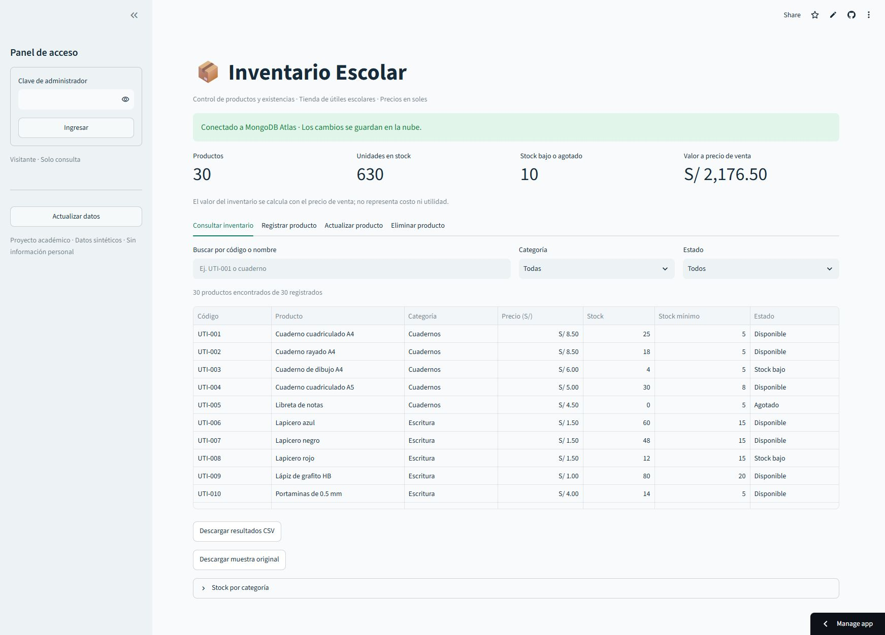

# Inventario Escolar

Aplicación web para gestionar el inventario de una tienda de útiles escolares. Permite registrar productos, consultar existencias, actualizar precios y stock, y eliminar registros con confirmación.

**[Abrir la aplicación](https://inventario-escolar-jeferson.streamlit.app/)**



## Funciones

- Búsqueda por código o nombre y filtros por categoría y disponibilidad.
- Alertas de stock bajo y productos agotados.
- Resumen de productos, unidades y valor a precio de venta.
- Registro, actualización y eliminación con acceso de administrador.
- Exportación CSV y carga de productos de ejemplo sin sobrescribir ediciones.
- Validación de datos, códigos únicos y control de cambios simultáneos.

La consulta es pública. Para modificar datos en la aplicación publicada se requiere una clave de administrador.

## Tecnologías

Python 3.12 · Streamlit · PyMongo · MongoDB Atlas · GitHub Actions

## Ejecutar localmente

```powershell
git clone https://github.com/jeferson1802a/inventario-escolar.git
cd inventario-escolar
python -m venv .venv
.\.venv\Scripts\python.exe -m pip install -r requirements.txt
.\.venv\Scripts\python.exe -m streamlit run app.py
```

Sin credenciales de MongoDB se activa un modo de demostración con datos temporales por sesión. Para usar persistencia en Atlas, consulta la [guía de configuración](docs/GUIA_PASO_A_PASO.md).

## Datos

La muestra incluye **30 productos sintéticos** distribuidos en seis categorías. Los precios se expresan en soles y no corresponden a una tienda real. El valor del inventario se calcula a precio de venta.

Consulta el [modelo de datos](docs/MODELO_DE_DATOS.md) para conocer los campos y las reglas de almacenamiento.

## Pruebas

```powershell
.\.venv\Scripts\python.exe -m pip install -r requirements-dev.txt
.\.venv\Scripts\python.exe -m unittest discover -s tests -v
```

La suite verifica validación, filtros, exportación, operaciones CRUD y acceso de administrador. Las pruebas automatizadas utilizan MongoDB simulado y se ejecutan en GitHub Actions.

## Estructura

```text
app.py                  Interfaz de Streamlit y acceso de administrador
inventory.py            Reglas de negocio y repositorios
data/productos.csv      Muestra de productos
docs/                   Configuración y modelo de datos
tests/                  Pruebas automatizadas
scripts/test_atlas.py   Verificación opcional con una base real
```

Las credenciales se configuran mediante secretos privados o variables de entorno y se excluyen del repositorio. El acceso con clave compartida está pensado para una demostración; un uso comercial requiere autenticación individual y auditoría.
