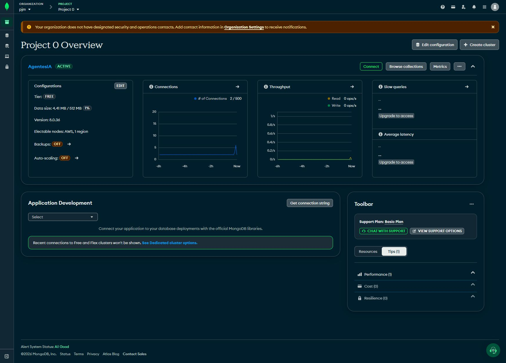
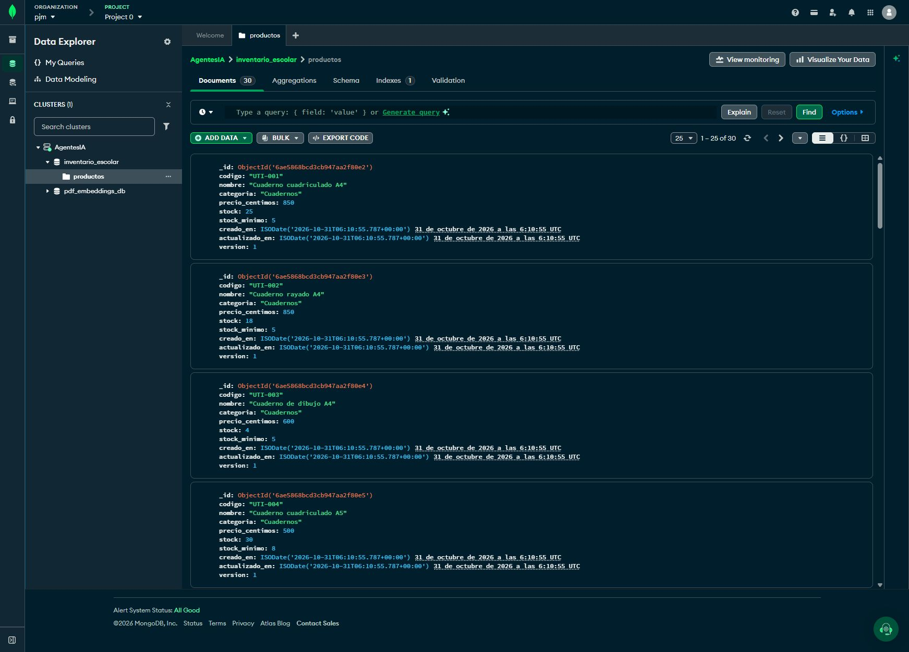
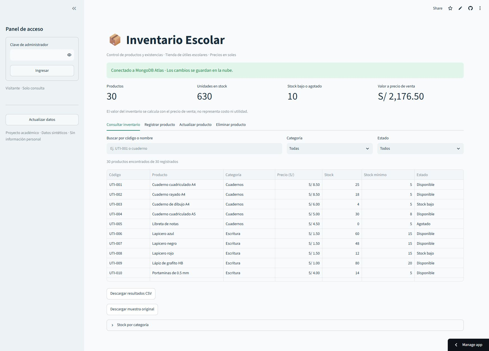
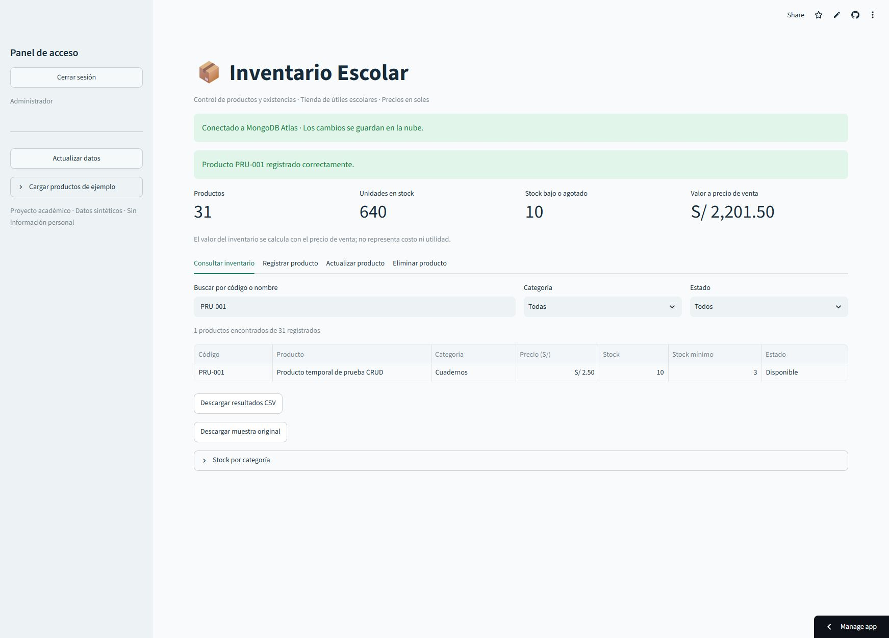
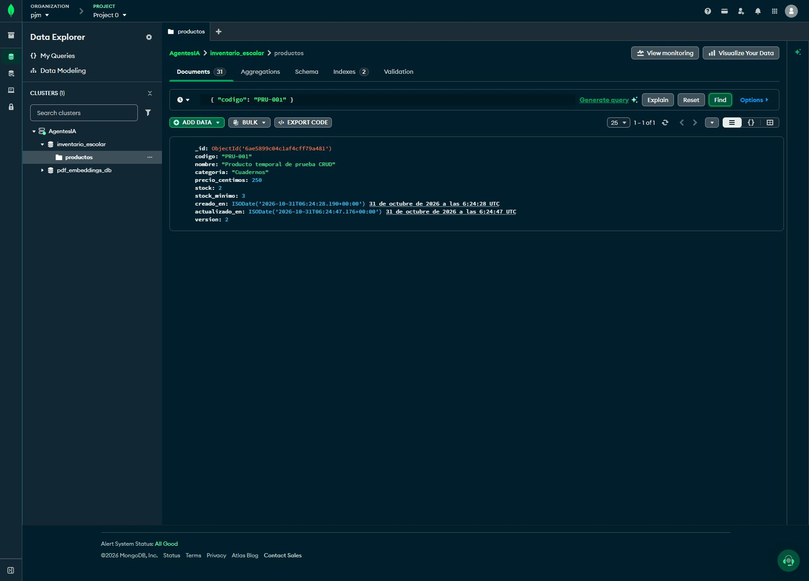
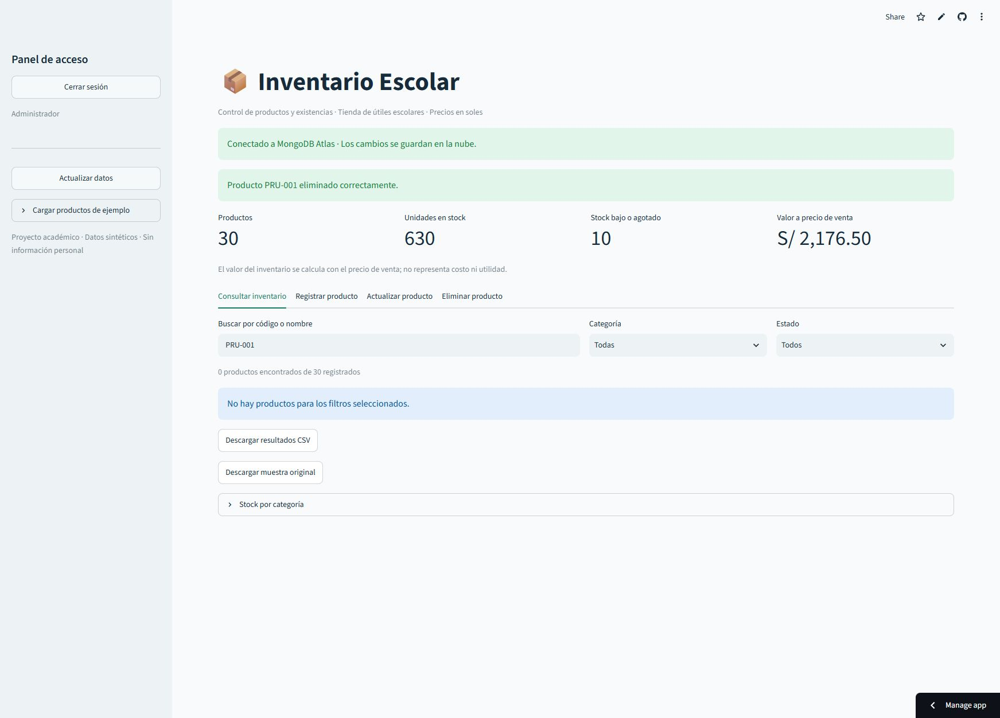

# Aplicación web de inventario escolar con MongoDB Atlas

Informe de diseño desarrollo y verificación

Estudiante o integrantes: [Completar nombres y códigos]
Curso y sección: [Completar]    Docente: [Completar]
Fecha: 31 de octubre de 2026

Se desarrolló y publicó una aplicación para gestionar el inventario de una tienda de útiles escolares. Las operaciones de registro, consulta, actualización y eliminación se probaron desde Streamlit y se comprobaron en MongoDB Atlas. El sistema terminó la verificación con los 30 productos originales.

## 1 Problemática y objetivo

Una pequeña tienda registra sus productos en cuadernos y archivos separados, lo que dificulta conocer existencias, actualizar precios y detectar productos por reponer. El objetivo es centralizar esta información en una aplicación web accesible desde el navegador. El alcance comprende el inventario de una tienda; no incluye facturación, ventas ni múltiples almacenes.

## 2 Diseño y datos

La arquitectura sigue el flujo navegador → Streamlit → reglas de negocio en Python → PyMongo → MongoDB Atlas. Se utiliza el clúster gratuito existente AgentesIA, con la base independiente inventario_escolar y la colección productos. GitHub aloja el código y Streamlit Community Cloud publica la interfaz con Python 3.12.

Cada documento contiene codigo, nombre, categoria, precio_centimos, stock, stock_minimo, creado_en, actualizado_en y version, además del identificador _id generado por MongoDB. Un índice único sobre codigo evita duplicados. El precio se almacena en céntimos enteros: 850 representa S/ 8.50. Las fechas se guardan en UTC y la versión permite detectar actualizaciones simultáneas.

El archivo data/productos.csv contiene 30 productos sintéticos de seis categorías. Los precios y existencias se crearon con fines académicos y no pertenecen a una tienda real. La muestra incluye productos disponibles, con stock bajo y agotados. No contiene datos personales.

## 3 Desarrollo y funcionamiento

La interfaz ofrece cuatro pestañas para consultar, registrar, actualizar y eliminar productos. La consulta permite buscar por código o nombre, filtrar por categoría y estado, y descargar resultados en CSV. El registro valida los campos; la edición conserva el código; la eliminación exige escribir el código exacto como confirmación.

El resumen muestra productos, unidades, artículos por reponer y valor a precio de venta. Un stock de cero indica Agotado; un stock positivo menor o igual al mínimo indica Stock bajo. El valor mostrado no representa costo ni utilidad.

La consulta es pública y las modificaciones requieren la clave de administrador. Los secretos se guardan fuera de GitHub y el usuario inventario_app tiene permiso readWrite únicamente sobre inventario_escolar. La clave compartida es una protección básica para la actividad; una solución comercial requeriría usuarios individuales y auditoría.

<!-- pagebreak -->

## 4 Pruebas y resultados

Se ejecutaron 13 pruebas automatizadas locales sobre validación, datos, dinero, filtros, CSV, duplicados, CRUD, concurrencia e interfaz. La primera ejecución de GitHub Actions también terminó correctamente. Las pruebas automatizadas con memoria y mongomock se distinguen de las siguientes verificaciones reales sobre Atlas.

- Conexión y consulta: la URL pública mostró Conectado a MongoDB Atlas y recuperó 30 productos, 630 unidades y valor a precio de venta de S/ 2,176.50.
- Registro: se comprobó que PRU-001 no existía y se creó Producto temporal de prueba CRUD, categoría Cuadernos, precio S/ 2.50, stock 10 y mínimo 3. La aplicación confirmó el registro y mostró 31 productos.
- Actualización: se cambió el stock de PRU-001 de 10 a 2. La consulta mostró Stock bajo. En Data Explorer de Atlas se verificaron precio_centimos 250, stock 2 y version 2.
- Eliminación: con autorización del responsable se eliminó únicamente PRU-001 desde Streamlit. La aplicación confirmó la operación y Atlas devolvió cero resultados para ese código.
- Estado final: permanecieron 30 productos y 630 unidades. Se observó el acceso de visitante antes del ingreso y de administrador después.

La comprobación del documento actualizado y de su posterior ausencia en Data Explorer confirma que los cambios llegaron a la base remota. No se afirma que el script local de integración se ejecutó con credenciales reales: estas permanecieron en Streamlit. El detalle está en docs/PLAN_DE_PRUEBAS.md.

## 5 Enlaces públicos

Aplicación: https://inventario-escolar-jeferson.streamlit.app/

Repositorio: https://github.com/jeferson1802a/inventario-escolar

Pruebas en GitHub: https://github.com/jeferson1802a/inventario-escolar/actions/runs/41175208075

## 6 Conclusiones

La solución centraliza el inventario, facilita las consultas y señala productos por reponer. La verificación real demostró las cuatro operaciones CRUD entre la aplicación publicada y MongoDB Atlas. Se entregan código, datos reproducibles, documentación y capturas reales del clúster, la colección y las operaciones.

## 7 Referencias

- MongoDB. Connect to an Atlas Cluster. https://www.mongodb.com/docs/atlas/connect-to-database-deployment/
- MongoDB. Configure Database Users. https://www.mongodb.com/docs/atlas/security-add-mongodb-users/
- Streamlit. File organization for your Community Cloud app. https://docs.streamlit.io/deploy/streamlit-community-cloud/deploy-your-app/file-organization
- Streamlit. Managing secrets when deploying your app. https://docs.streamlit.io/deploy/concepts/secrets

<!-- pagebreak -->

## 8 Evidencias del clúster y la colección

Las capturas corresponden al entorno real de Atlas y Streamlit y no muestran credenciales.

Figura 1 Clúster AgentesIA activo en el nivel gratuito.

Figura 2 Base inventario_escolar y colección productos con la muestra inicial.

<!-- pagebreak -->

## 9 Evidencias de consulta y registro

Figura 3 Aplicación pública conectada a Atlas con los 30 productos de la muestra.

Figura 4 Registro de PRU-001 confirmado y consulta del nuevo producto.

<!-- pagebreak -->

## 10 Evidencias de actualización y eliminación

Figura 5 Documento PRU-001 en Atlas con stock 2 y version 2 después de actualizarlo.

Figura 6 Eliminación de PRU-001 confirmada y regreso a 30 productos.

